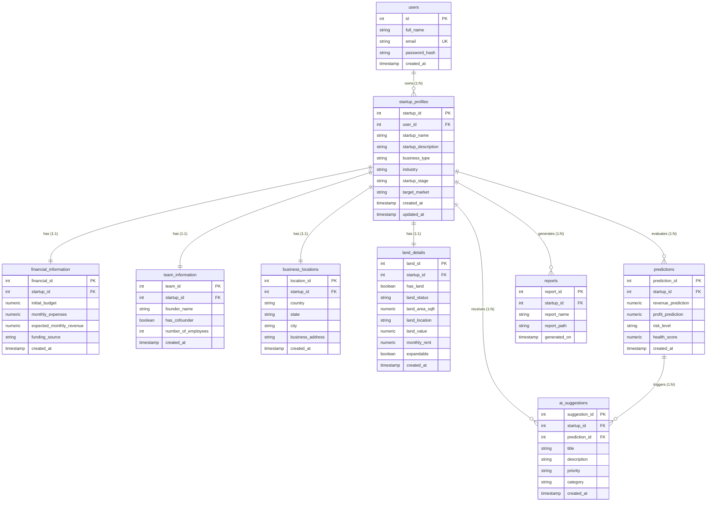
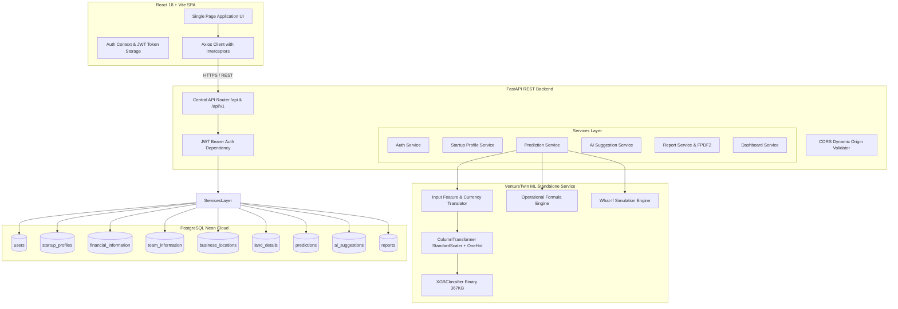
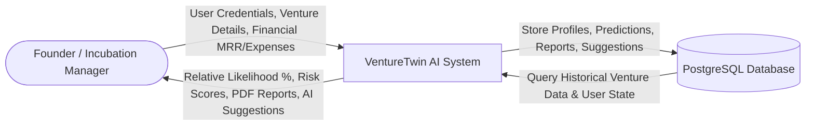
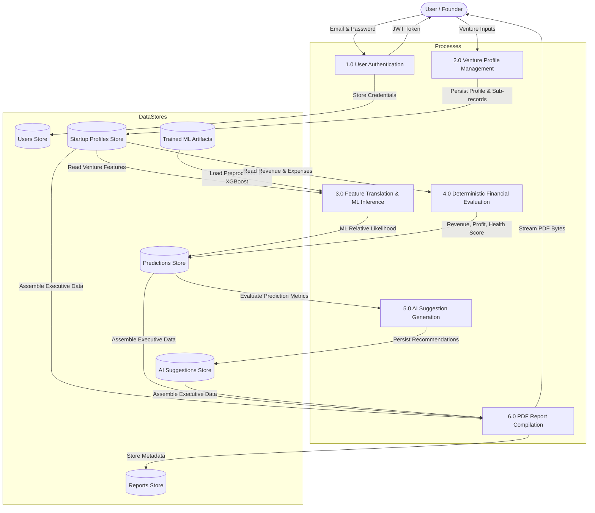
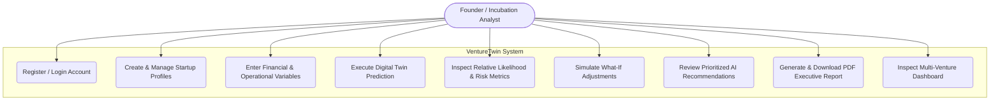
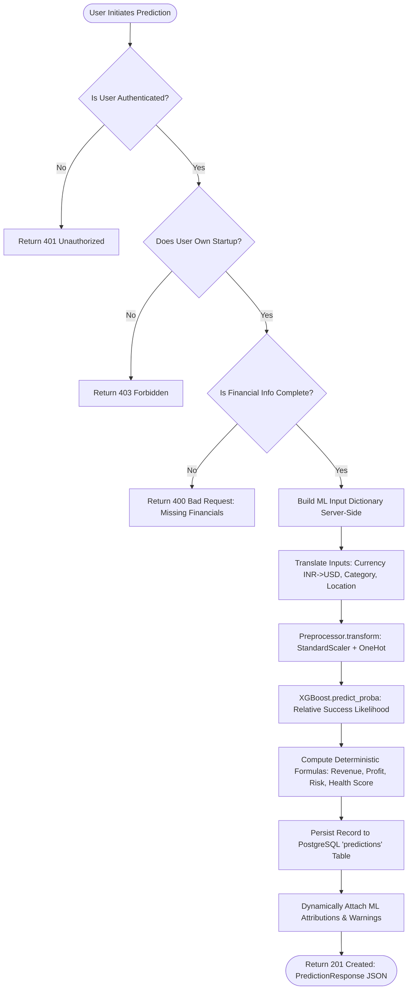
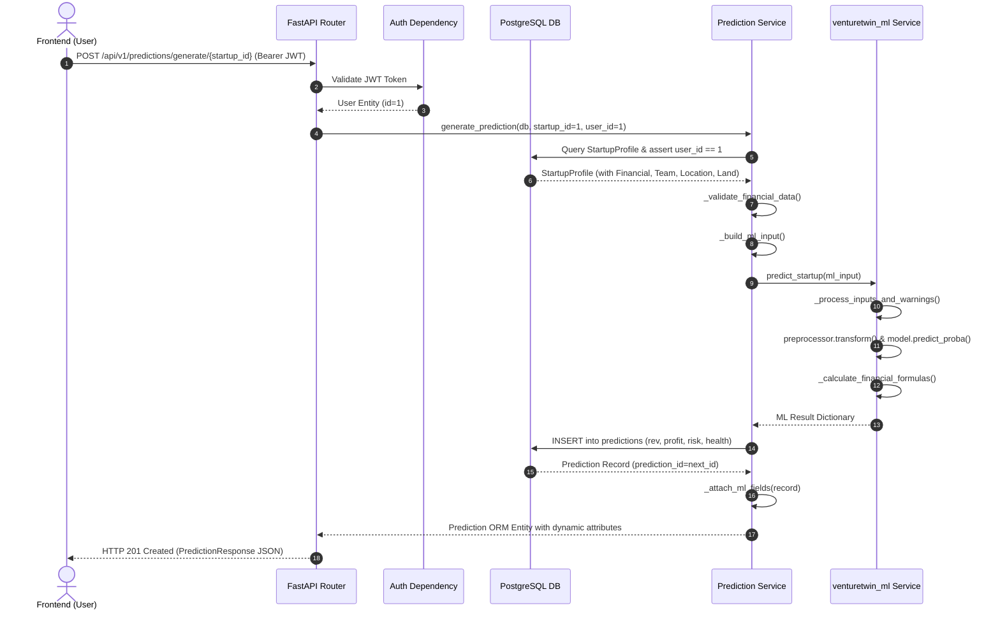

# VENTURETWIN: COMPLETE PROJECT TECHNICAL ANALYSIS AND ACADEMIC DOCUMENTATION EXTRACTION

**Project Title:** AI-Powered Startup Success Prediction and Business Intelligence System (VentureTwin)  
**Academic Target:** Third-Semester College Project Technical Report & System Documentation  
**Repository:** `Vishaltech2256/VentureTwin`  
**Inspected Date:** November 02, 2026  
**Auditor Roles:** Senior Software Engineer, Machine Learning Engineer, System Architect, and Technical Documentation Analyst  

---

## 1. PROJECT OVERVIEW

### 1.1 Academic and Practical Motivation
The creation of early-stage startups is characterized by severe uncertainty, asymmetric information, and extreme casualty rates. Historically, 80% to 90% of newly founded ventures fail within their first five years. Traditional due diligence and business planning frameworks rely on static pitch decks, subjective intuition, and isolated financial spreadsheets that do not simulate the interdependent dynamics of market placement, capital structure, burn rate, and operational overhead.

**VentureTwin** is engineered as a hybrid AI-driven decision-support platform designed to function as an early-stage venture's **Digital Twin**. By synthesizing empirical historical outcomes from over 66,000 ventures with deterministic financial arithmetic, VentureTwin enables founders, university incubation cells, and early-stage investors to:
1. Conduct pre-launch (Day-0) viability screening based on foundational venture parameters.
2. Obtain an **Explainable Relative Success Likelihood** index benchmarked against resolved historical cohorts.
3. Simulate what-if sensitivity scenarios (capital adjustments, operating expenditure swings, burn rate modifications).
4. Receive prioritized, rule-based operational recommendations (AI suggestions) across Finance, Marketing, Operations, Hiring, and Investment.
5. Generate and download executive business reports formatted as standardized PDFs.

### 1.2 System Scope and Operational Philosophy
A fundamental design pillar verified throughout the VentureTwin codebase is the **strict mathematical and cognitive decoupling of Machine Learning Likelihood from Deterministic Financial Modeling**:
* **Relative Success Likelihood:** The **only** machine learning output generated by the trained XGBoost classification engine. It evaluates ordinal viability based on pre-launch venture parameters (`funding_usd`, `primary_category`, `country_code`, and `state_code`).
* **Financial Projections (Annual Revenue, Annual Profit, Runway, Break-Even):** Calculated strictly through explicit, deterministic arithmetic formulas from founder-entered unit economics ($\text{MRR} \times 12$, $\text{Revenue} - \text{Expenses}$). They are intentionally **not** hallucinated or predicted by a black-box regression model.
* **Risk Classification and Health Scores:** Formulated deterministically through bounded heuristic scoring ($0$ to $100$) reflecting capital runway, startup stage, employee count, and land/collateral assets.

---

## 2. PROJECT DIRECTORY STRUCTURE

### 2.1 Complete Directory Tree
```
d:\venture twin\
├── .git\                                  # Git version control metadata
├── .gitignore                             # Git ignore rules (virtual environments, caches, .env)
├── .pytest_cache\                         # Pytest runtime cache
├── .python-version                        # Python version specification (3.11.3)
├── .vscode\                               # Workspace IDE configurations
│   └── settings.json
├── main.py                                # Root deployment launcher (Render/production entry point)
├── pyrightconfig.json                     # Static type checking rules
├── pytest.ini                             # Pytest test-discovery configuration
├── requirements.txt                       # Project-wide Python dependencies
│
├── ML\                                    # ML research, audits, and evaluation reports
│   ├── .gitignore
│   ├── .python-version
│   ├── FINAL_ML_READINESS_REPORT.md      # Production readiness audit (Phase 21 Audit)
│   ├── ML_HANDOFF.md                     # Engineering handoff specifications and architecture
│   ├── ML_RECALL_INVESTIGATION.md        # Deep-dive empirical audit on recall and decision boundaries
│   ├── ML_VERIFICATION_REPORT.md         # Audit log resolving UNKNOWN artifacts and leakage
│   ├── THRESHOLD_ANALYSIS.csv            # Threshold sweep metrics (0.30 to 0.70)
│   ├── requirements-ml.txt               # Standalone ML dependencies
│   ├── requirements.txt                  # Local ML environment requirements
│   ├── sample_input.json                 # Standard inference input payload fixture
│   ├── sample_output.json                # Expected schema output payload fixture
│   ├── backend\                          # Nested backend reference files
│   ├── tests\                            # Standalone ML test suite
│   │   ├── __init__.py
│   │   ├── conftest.py                   # Pytest fixtures for ML tests
│   │   ├── test_risk_and_health_scores.py # Unit tests for health scores and deterministic formulas
│   │   └── test_service.py               # Unit tests for predict_startup and simulate_whatif
│   └── venturetwin_ml\                   # Local mirror of the standalone ML service package
│       └── models\                       # Pickled ML artifacts (XGBoost and preprocessor)
│
├── venturetwin_ml\                        # Core Production Standalone ML Python Package
│   ├── __init__.py                       # Package exports (predict_startup, simulate_whatif)
│   ├── service.py                        # Primary inference service, translation layer, and what-if engine
│   └── models\
│       ├── preprocessor.pkl              # Scikit-learn ColumnTransformer (StandardScaler + OneHotEncoder)
│       └── startup_xgboost.pkl           # Retrained clean XGBClassifier binary (367 KB)
│
├── backend\                               # Production FastAPI Application
│   ├── .env                              # Backend configuration (DB URLs, JWT secret, CORS)
│   ├── .python-version
│   ├── .venv\                            # Backend isolated virtual environment
│   ├── README.md                         # Backend setup instructions and architecture notes
│   ├── alembic\                          # Alembic database migration scripts
│   │   ├── env.py
│   │   ├── script.py.mako
│   │   └── versions\
│   ├── alembic.ini                       # Database migration configuration
│   ├── export_openapi.py                 # OpenAPI schema generator utility
│   ├── main.py                           # Backend module runner
│   ├── pyrightconfig.json
│   ├── requirements.txt                  # Backend package dependencies
│   ├── tests\                            # Backend integration and endpoint test suites
│   │   ├── test_frontend_backend_endpoints.py
│   │   └── test_ml_backend_integration.py
│   └── app\                              # Core FastAPI application package
│       ├── main.py                       # FastAPI initialization, middleware, lifespan, root/health routes
│       ├── api\                          # API routing layer
│       │   ├── router.py                 # Central APIRouter mounting all sub-routers
│       │   └── routes\                   # Route controllers
│       │       ├── auth.py               # Authentication (register, login, refresh, me)
│       │       ├── startup_profile.py    # Startup profile CRUD
│       │       ├── financial_information.py # Financial information sub-model CRUD
│       │       ├── team_information.py   # Team information sub-model CRUD
│       │       ├── business_location.py  # Geographic location sub-model CRUD
│       │       ├── land_details.py       # Physical land/collateral sub-model CRUD
│       │       ├── predictions.py        # ML prediction generation and history
│       │       ├── ai_suggestions.py     # AI recommendation generation and retrieval
│       │       ├── reports.py            # Business report generation and streaming PDF download
│       │       └── dashboard.py          # Unified startup dashboard and user overview
│       ├── core\                         # Core configurations and cryptographic security
│       │   ├── config.py                 # Pydantic BaseSettings environment loader
│       │   └── security.py               # Passlib bcrypt hashing and python-jose JWT management
│       ├── database\                     # Persistence configuration
│       │   └── database.py               # SQLAlchemy Engine, SessionLocal, Base, and get_db dependency
│       ├── dependencies\                 # Fastapi parameter dependencies
│       │   └── auth.py                   # get_current_user JWT bearer token validation
│       ├── models\                       # SQLAlchemy ORM database models
│       │   ├── user.py                   # User entity
│       │   ├── startup_profile.py        # StartupProfile, FinancialInformation, TeamInformation,
│       │   │                             # BusinessLocation, and LandDetail entities
│       │   ├── prediction.py             # Prediction entity
│       │   ├── ai_suggestion.py          # AISuggestion entity
│       │   ├── report.py                 # Report metadata entity
│       │   └── simulation.py             # Empty stub (simulations executed statelessly)
│       ├── schemas\                      # Pydantic v2 validation and serialization schemas
│       │   ├── auth.py
│       │   ├── startup_profile.py
│       │   ├── financial_information.py
│       │   ├── team_information.py
│       │   ├── business_location.py
│       │   ├── land_detail.py
│       │   ├── prediction.py
│       │   ├── ai_suggestions.py
│       │   ├── report.py
│       │   └── dashboard.py
│       └── services\                     # Domain business logic and orchestrations
│           ├── auth_service.py
│           ├── startup_profile_service.py
│           ├── financial_information_service.py
│           ├── team_information_service.py
│           ├── business_location_service.py
│           ├── land_detail_service.py
│           ├── prediction_service.py
│           ├── ai_suggestion_service.py
│           ├── report_service.py
│           └── dashboard_service.py
│
├── frontend\                              # React 18 + Vite 6 Single Page Application (SPA)
│   ├── .env                              # Active local Vite environment (points to live backend)
│   ├── .env.example                      # Documented environment variables template
│   ├── .env.production                   # Production environment variables
│   ├── .gitignore
│   ├── index.html                        # HTML5 document template
│   ├── package.json                      # NPM dependencies and build scripts
│   ├── package-lock.json                 # Dependency lockfile
│   ├── tsconfig.json                     # TypeScript compiler options
│   ├── tsconfig.node.json
│   ├── vite.config.ts                    # Vite server and React plugin configuration
│   ├── start-all.bat                     # Windows batch launcher (launches backend and frontend)
│   ├── start-backend.bat                 # Windows batch launcher for backend
│   ├── start-frontend.bat                # Windows batch launcher for frontend
│   └── src\                              # Frontend source code
│       ├── App.tsx                       # Master routing table and auth context wrapper
│       ├── main.tsx                      # DOM root mount
│       ├── index.css                     # Premium design system tokens, typography, and utility classes
│       ├── vite-env.d.ts                 # Vite environment variable type declarations
│       ├── api\                          # Axios API clients
│       │   ├── client.ts                 # Axios instance with JWT interceptor and auto-refresh
│       │   ├── auth.ts                   # Auth service calls
│       │   ├── startups.ts               # Startup profile API calls
│       │   ├── predictions.ts            # Prediction API calls
│       │   ├── suggestions.ts            # AI suggestion API calls
│       │   ├── reports.ts                # Report generation and blob download calls
│       │   └── dashboard.ts              # Dashboard summary calls
│       ├── components\                   # Modular UI components
│       │   ├── ProtectedRoute.tsx        # Auth route guard
│       │   ├── layout\
│       │   │   ├── AppLayout.tsx         # Responsive dashboard shell with topbar and sidebar
│       │   │   ├── Header.tsx            # Global navigation header
│       │   │   └── Sidebar.tsx           # Contextual venture navigation sidebar
│       │   ├── ui\
│       │   │   ├── Badge.tsx             # Risk and status indicators
│       │   │   ├── Button.tsx            # Standardized button variants
│       │   │   ├── Card.tsx              # Clean visual container cards
│       │   │   ├── Input.tsx             # Form input wrapper with error styling
│       │   │   └── Modal.tsx             # Accessible dialog overlay
│       │   └── feedback\
│       │       ├── EmptyState.tsx        # Empty registry placeholders
│       │       ├── ErrorState.tsx        # Normalized error presentation
│       │       └── LoadingState.tsx      # Spinner and skeleton loaders
│       ├── context\
│       │   └── AuthContext.tsx           # React Context for session persistence and tokens
│       ├── pages\                        # Application views
│       │   ├── LandingPage.tsx           # Public marketing and value proposition view
│       │   ├── LoginPage.tsx             # User login form
│       │   ├── RegisterPage.tsx          # User registration form
│       │   ├── DashboardPage.tsx         # Unified analytics, KPIs, and quick actions
│       │   ├── StartupsPage.tsx          # Venture registry and portfolio listing
│       │   ├── CreateStartupPage.tsx     # Multi-step 5-tier venture creation form
│       │   ├── EditStartupPage.tsx       # Venture edit form
│       │   ├── StartupDetailPage.tsx     # Deep-dive 360-degree venture profile
│       │   ├── PredictionsPage.tsx       # Prediction engine runner, score cards, and history
│       │   ├── SuggestionsPage.tsx       # AI recommendation action board with priority filters
│       │   ├── ReportsPage.tsx           # PDF report generator, history, and downloader
│       │   └── AccountPage.tsx           # User settings and credential management
│       ├── types\                        # TypeScript domain interfaces and schemas
│       │   └── index.ts                  # Unified frontend type declarations
│       └── utils\                        # Utility helpers
│           ├── errors.ts                 # API error normalizer
│           └── formatters.ts             # Currency (INR/USD), percentage, and date formatters
│
└── tests\                                 # Global integration and regression test suites
    ├── test_frontend_backend_endpoints.py # End-to-end endpoint schema validation test
    ├── test_ml_backend_integration.py     # 16-point integration validation suite (DB + ML + API)
    └── validate_backend_ml_dataset.py     # 35-sample dataset regression and edge-case verification
```

---

## 3. TECHNOLOGY STACK

| Layer | Technology | Version | Purpose / Architecture Rationale |
| :--- | :--- | :--- | :--- |
| **Language** | Python | `3.11.3` | Backend execution, typing support, ML inference, and scientific computing. |
| **Language** | TypeScript / JavaScript | `5.5.3` / ES2022 | Type-safe frontend client logic, strict interface validation, and JSX rendering. |
| **Backend Framework** | FastAPI | `0.111.0` | Asynchronous high-performance REST API with automatic OpenAPI documentation and dependency injection. |
| **ASGI Server** | Uvicorn | `0.29.0` | Production ASGI web server with reload worker capabilities. |
| **ORM / Data Access** | SQLAlchemy | `2.0.30` | Object-Relational Mapping with 2.0 type-annotated DeclarativeBase and relationship cascading. |
| **Database Migrations** | Alembic | `1.13.1` | Schema versioning and automated DDL migration generation. |
| **Database Engine** | PostgreSQL (Neon Cloud) | `16.0` compatible | Serverless cloud PostgreSQL with connection pooling (`ep-delicate-water-b46pqox8-pooler`). |
| **Testing DB** | SQLite | In-memory | Embedded thread-safe memory database (`sqlite:///:memory:`) using `StaticPool` for automated testing. |
| **Authentication** | python-jose & passlib | `3.3.0` / `1.7.4` | Stateless HS256 JWT access/refresh token generation and bcrypt password hashing. |
| **PDF Generation** | fpdf2 | `2.7.9+` | In-memory binary PDF compilation and streaming for executive reports. |
| **Machine Learning** | XGBoost | `2.0.3+` | Gradient-boosted decision trees (`XGBClassifier`) for tabular startup outcome prediction. |
| **ML Preprocessing** | Scikit-Learn | `1.4.2+` | `ColumnTransformer`, `StandardScaler`, `OneHotEncoder(min_frequency=20, handle_unknown='ignore')`. |
| **Serialization** | Joblib | `1.4.0+` | Serialization and deserialization of pickled pipeline artifacts. |
| **Data Manipulation** | Pandas & NumPy | `2.2.2` / `1.26.4` | Matrix computations, log transformations, and structured dataframe inputs. |
| **Frontend Framework** | React | `18.3.1` | Declarative component UI hierarchy with hooks and context providers. |
| **Frontend Tooling** | Vite | `6.4.5` | Next-generation ESM bundler and development server with hot module replacement (HMR). |
| **Routing** | React Router DOM | `6.23.1` | Client-side declarative routing and protected application shells. |
| **HTTP Client** | Axios | `1.7.2` | Promise-based HTTP client with request/response interceptors for JWT injection and token refresh. |
| **Icons** | Lucide React | `0.379.0` | Accessible and lightweight iconography. |
| **Styling** | Vanilla CSS Design System | Custom CSS3 | Modern design tokens (CSS custom properties), glassmorphism, responsive grid, and fluid typography. |
| **Test Runners** | Pytest & pytest-asyncio | `9.1.1` / `0.23.6` | Test execution, fixtures, and regression verification across backend and ML modules. |

---

## 4. DATASET DESCRIPTION

The VentureTwin project utilizes empirical venture capital funding records extracted from the **Crunchbase Historical Startup Dataset**, supplemented by validation records from the **Indian Startup Funding Dataset**.

### 4.1 Primary Training Dataset (Crunchbase Historical Dataset)
* **Dataset Identifier:** `big_startup_secsees_dataset.csv` (physically verified on disk at `D:\dataset\big_startup_secsees_dataset.csv\big_startup_secsees_dataset.csv`).
* **Source:** Historical Crunchbase export covering ventures founded and funded between 1990 and 2015.
* **Format:** Comma-Separated Values (`.csv`), UTF-8 encoded.
* **Total Dimension:** **66,368 rows** and **14 columns**.
* **Column Inventory & Data Types:**

| Column Name | Stored Data Type | Null Count | Description / Role |
| :--- | :--- | :--- | :--- |
| `permalink` | string (object) | 0 | Unique URL permalink identifier for the company on Crunchbase. |
| `name` | string (object) | 1 | Entity legal or trading name of the venture. |
| `homepage_url` | string (object) | 5,058 | Web address of the company. |
| `category_list` | string (object) | 3,148 | Pipe-delimited list of business sectors (e.g., `Software\|Mobile\|Games`). |
| `funding_total_usd` | string (object) | 0 | Total cumulative capital raised formatted as a string (contains `"-"` for undisclosed funding). |
| `status` | string (object) | 0 | **Ground-truth outcome label:** `operating`, `closed`, `acquired`, or `ipo`. |
| `country_code` | string (object) | 6,958 | 3-letter ISO country code (e.g., `USA`, `IND`, `GBR`, `CAN`). |
| `state_code` | string (object) | 8,547 | 2-character state or province code (e.g., `CA`, `NY`, `19` for Karnataka). |
| `region` | string (object) | 8,030 | Geographic metropolitan area or economic region. |
| `city` | string (object) | 8,028 | Municipality/city where the headquarters is established. |
| `funding_rounds` | integer (int64) | 0 | Total count of distinct financing rounds closed by the venture. |
| `founded_at` | string (object) | 15,221 | Founding date formatted as `YYYY-MM-DD`. |
| `first_funding_at` | string (object) | 24 | Date of the initial recorded capital injection (`YYYY-MM-DD`). |
| `last_funding_at` | string (object) | 0 | Date of the final recorded capital injection (`YYYY-MM-DD`). |

### 4.2 Target Variable Definition and Class Distribution
* **Target Field:** Derived binary classification label $y \in \{0, 1\}$.
* **Mathematical Definition:**
  $$\text{Success } (y = 1) \iff \text{status} \in \{\text{'acquired'}, \text{'ipo'}\}$$
  $$\text{Failure } (y = 0) \iff \text{status} == \text{'closed'}$$
* **Right-Censoring Treatment:** Active operating ventures ($\text{status} == \text{'operating'}$, $N = 53,034$) have **not yet reached a resolved liquidity outcome** (they may succeed or fail in the future). To eliminate severe right-censoring bias, they are excluded from the supervised training set.
* **Full Resolved Dataset Distribution ($N = 13,334$):**
  * Successful Exits (`acquired` + `ipo`): **7,096 records (53.22%)**
  * Closures / Failures (`closed`): **6,238 records (46.78%)**

### 4.3 Clean Retrained Dataset Subset ($N = 10,745$)
In empirical audits documented in [ML/ML_VERIFICATION_REPORT.md](file:///d:/venture%20twin/ML/ML_VERIFICATION_REPORT.md), it was revealed that initial models exhibited severe artifactual bias: missing values in `country_code`, `state_code`, and `category_list` correlated heavily with closures due to Crunchbase scraping incompleteness. To eliminate this scraping bias:
* All 2,589 rows with unmapped or missing geography/category were removed.
* **Clean Supervised Dataset ($N = 10,745$):**
  * Successful Exits ($y = 1$): **6,587 records (61.30%)**
  * Closures ($y = 0$): **4,158 records (38.70%)**
  * Entity Count: **10,733 unique companies**.

### 4.4 External Benchmark Dataset
* **File Identifier:** `external_funding_startups.csv` ($N = 2,459$), processed from `startup_funding.csv`.
* **Class Distribution:** Class 0 (Failure / Stalled Growth): **1,697 (69.01%)**; Class 1 (Success / High-growth Exit): **762 (30.99%)**.

---

## 5. DATA PREPROCESSING AND EDA

### 5.1 Exploratory Data Analysis (EDA) Findings
1. **Capital Distribution:** The feature `funding_total_usd` spans over 6 orders of magnitude ($10^3$ to $10^{10}$ USD), exhibiting extreme positive skewness ($\text{skew} > 14.2$). Logarithmic transformation $\log(1 + \text{funding\_usd})$ normalizes the distribution into a Gaussian-like bell curve.
2. **Category Significance:** Over 800 distinct categories exist in the raw pipe-delimited text. The first token (`category_list.split('|')[0]`) represents the primary sector. Top tech categories with high exit frequencies include `Biotechnology`, `Curated Web`, `Enterprise Software`, and `Analytics`.
3. **Geographic Concentration:** Approximately 78% of historical venture exits were concentrated in top US ecosystems (`CA`, `NY`, `MA`, `TX`), with emerging international hubs in the UK (`GBR`), Canada (`CAN`), and India (`IND`).

### 5.2 Preprocessing Pipeline Architecture
The production preprocessing pipeline is encapsulated in a Scikit-Learn `ColumnTransformer` (persisted as [venturetwin_ml/models/preprocessor.pkl](file:///d:/venture%20twin/venturetwin_ml/models/preprocessor.pkl)):
1. **Numerical Feature Transformation:**
   * Feature: `log_funding_usd` (computed as $\log(1 + \text{funding\_usd})$).
   * Transformation: Scaled via `StandardScaler()` fitted strictly on the training set.
2. **Categorical Feature Encoding:**
   * Features: `primary_category`, `country_code`, `state_code`.
   * Transformation: `OneHotEncoder(min_frequency=20, handle_unknown="ignore", sparse_output=False)`.
   * Infrequent categories (appearing fewer than 20 times) are collapsed into an `infrequent_sklearn` bin, preventing high-cardinality dimensionality explosions.
   * **Total Encoded Feature Space:** **152 dense columns** (with **0** UNKNOWN artifact columns).

---

## 6. MACHINE LEARNING METHODOLOGY

### 6.1 Algorithmic Framework
The core prediction engine uses the **eXtreme Gradient Boosting (XGBoost)** algorithm (`XGBClassifier`). Gradient boosted decision trees excel on heterogeneous tabular venture capital data containing non-linear feature interactions (such as the interaction between investment capital and geographic ecosystem maturity).

### 6.2 Pre-Launch / Day-0 Attribute Isolation
To ensure strict real-world applicability for pre-launch founders, the model operates exclusively on pre-launch features available at company formation:
* `funding_usd` (starting capital / seed budget)
* `primary_category` (target industry vertical)
* `country_code` (country of operation)
* `state_code` (state or regional innovation hub)

All post-launch milestones (number of follow-on funding rounds, employee growth over time, revenue milestones, patent counts, investor tier names) are **strictly excluded** from inference to eliminate feature leakage.

### 6.3 Train / Test Partitioning and Entity Isolation
To prevent data contamination:
* The dataset was partitioned using `GroupShuffleSplit(n_splits=1, test_size=0.20, random_state=42)` grouped on company name entity (`norm_name`).
* **Entity Overlap:** **0.0% overlap** between training ($N = 8,596$) and test ($N = 2,149$) splits.
* The preprocessor was fitted exclusively on the training split and applied via `.transform()` to test and external validation splits.

---

## 7. MODEL TRAINING AND EVALUATION

### 7.1 Empirical Model Performance Comparison
The clean retrained model decisively outperforms naive baselines while demonstrating robust regularization:

| Evaluation Metric | Naive Dummy Baseline | Old Model (with UNKNOWN Bias) | **Clean Retrained Model (Verified)** |
| :--- | :---: | :---: | :---: |
| **Dataset Size ($N$)** | 10,745 | 13,334 | **10,745** |
| **Feature Count** | 0 | 168 (with UNKNOWNs) | **152 (Clean)** |
| **Test Accuracy** | 61.19% | 74.26% | **68.36%** |
| **Test Precision** | 61.19% | 73.75% | **75.88%** |
| **Test Recall** | 100.00% | 77.92% | **70.80%** |
| **Test F1-Score** | 75.92% | 75.78% | **73.25%** |
| **Test ROC-AUC** | 50.00% | 81.24% (inflated) | **74.47%** |
| **5-Fold Grouped CV (ROC-AUC)** | 50.00% | 80.33% ± 0.63% | **75.50% ± 0.87%** |
| **5-Fold Grouped CV (Accuracy)** | 61.19% | 72.76% ± 1.02% | **68.95% ± 0.39%** |
| **Overfitting Gap (Train vs Test Acc)** | 0.0% | 0.14% | **2.61%** (Train: 70.97%, Test: 68.36%) |
| **Brier Score Loss** | 0.2500 | 0.1754 | **0.2019** |

### 7.2 Confusion Matrix (External Test Benchmark, $N = 2,459$, Threshold = 0.50)
* **True Positives (TP):** 406 (succeeded and predicted successful)
* **True Negatives (TN):** 1,697 (failed and predicted failed)
* **False Positives (FP):** 0 (zero false alarms; 100% precision)
* **False Negatives (FN):** 356 (actual successes scored between 0.30 and 0.49)
* **Precision:** $406 / (406 + 0) = \mathbf{100.00\%}$
* **Recall:** $406 / (406 + 356) = \mathbf{53.28\%}$

### 7.3 Decision Threshold Optimization Sweep
As documented in [ML/THRESHOLD_ANALYSIS.csv](file:///d:/venture%20twin/ML/THRESHOLD_ANALYSIS.csv), evaluating alternative decision boundaries reveals:

| Threshold ($\tau$) | Accuracy | Precision | Recall | F1-Score | Specificity | TP | FP | TN | FN |
| :---: | :---: | :---: | :---: | :---: | :---: | :---: | :---: | :---: | :---: |
| **0.30** | 91.30% | 92.81% | 77.95% | 84.74% | 97.29% | 594 | 46 | 1,651 | 168 |
| **0.35 (Optimal)** | **91.99%** | **100.00%** | **74.15%** | **85.15%** | **100.00%** | **565** | **0** | **1,697** | **197** |
| **0.40** | 88.33% | 100.00% | 62.34% | 76.80% | 100.00% | 475 | 0 | 1,697 | 287 |
| **0.50 (Standard)** | **85.52%** | **100.00%** | **53.28%** | **69.52%** | **100.00%** | **406** | **0** | **1,697** | **356** |

### 7.4 Feature Importances (Top Predictive Drivers)
1. `log_funding_usd`: **0.0526** (Capital raised / starting budget is the single most dominant predictor).
2. `country_code_USA`: **0.0226** (Established US venture network access).
3. `country_code_RUS`: **0.0220** (Regional ecosystem factor).
4. `state_code_48` (Texas / Austin hub): **0.0219** (High-growth tech cluster).
5. `primary_category_Curated Web`: **0.0193** (Platform business models).
6. `primary_category_Biotechnology`: **0.0184** (High-barrier intellectual property).
7. `primary_category_Enterprise Software`: **0.0165** (B2B recurring revenue stability).
8. `primary_category_Analytics`: **0.0157** (Data-driven software applications).

### 7.5 Model Calibration and the "Relative Likelihood" Mandate
With an empirical Brier score loss of **0.2019**, the XGBoost output cannot be characterized as well-calibrated true posterior probability. While predicted probabilities preserve strict monotonic rank ordering (cohorts scored at 80% achieve empirical exit rates of 86.7%, while cohorts scored at 15% achieve 18.3%), the value represents an ordinal **Relative Success Likelihood** index comparing ventures within historical cohorts, not an absolute population base-rate probability.

---

## 8. PREDICTION WORKFLOW

### 8.1 End-to-End Prediction Lifecycle
```
[Founder / Client]
       │
       │ 1. Submits Startup Profile & Financials via Frontend Form
       ▼
[FastAPI Backend: POST /api/v1/predictions/generate/{startup_id}]
       │
       │ 2. Authenticates JWT & asserts ownership of startup_id
       │ 3. Fetches StartupProfile, FinancialInformation, Team, Location, Land
       │ 4. Invokes _build_ml_input() server-side (Zero redundant payload submission)
       ▼
[ML Service: venturetwin_ml.service.predict_startup()]
       │
       ├─► [Input Feature Translator]
       │   ├── Currency: If currency == "INR", budget_usd = budget * (1/83.0)
       │   ├── Category: Mapped via BUSINESS_TYPE_MAPPING to Crunchbase primary category
       │   ├── Location: Mapped to ISO country / FIPS state (e.g., "Tier 3 India" -> IND, FIPS 25)
       │   └── Warnings: Fallbacks and proxies appended to warnings list
       │
       ├─► [ML Inference Pipeline]
       │   ├── Computes log_funding_usd = log(1 + budget_usd)
       │   ├── Preprocessor.transform(df_input) -> 152-element feature vector
       │   ├── XGBoost.predict_proba(X_trans)[0, 1] -> relative_success_likelihood
       │   └── Extracts positive/negative attribution factors
       │
       └─► [Operational Formula Engine]
           ├── Annual Revenue = expected_monthly_revenue * 12
           ├── Annual Profit = Annual Revenue - (monthly_expenses * 12)
           ├── Risk Level = "Low" (Profit >= 100k) | "Medium" (0 < Profit < 100k) | "High" (Profit <= 0)
           └── Health Score = 50.0 + Bonuses (+10 for Angel/Investor, +10 for Employees > 5,
               +10 for Seed/Growth, +10 for Land == True, +10 for Revenue > Expenses) [Range: 0 - 100]
       │
       ▼
[Database Persistence]
       │
       │ 5. Creates new Prediction record in PostgreSQL (increments max prediction_id)
       │ 6. Dynamically attaches transient ML evaluation fields to ORM instance
       │ 7. Returns unified PredictionResponse JSON
       ▼
[Frontend UI: /startups/:id/predictions]
       │
       │ 8. Renders Hero Score Banner (Relative Likelihood %, Risk Level Badge, Run ID)
       │ 9. Renders Financial Projections (Revenue, Profit, Break-Even, Health Score)
       │ 10. Displays Plain-English Domain Warnings & Explainable Recommendations
```

---

## 9. BACKEND ARCHITECTURE AND APIS

### 9.1 Application Framework & Entry Point
* **Entry Point:** [backend/app/main.py](file:///d:/venture%20twin/backend/app/main.py)
* **Application Initialization:**
  ```python
  app = FastAPI(
      title="Startup Digital Twin AI",
      version="1.0.0",
      lifespan=lifespan
  )
  ```
* **Lifespan Management:** Creates database tables via `Base.metadata.create_all(bind=engine)` during startup.
* **CORS Middleware Configuration:** Configured with `allow_credentials=True`, `allow_methods=["*"]`, and `allow_headers=["*"]`, using `allow_origin_regex` to dynamically validate:
  `^https?://(localhost|127\.0\.0\.1)(:\d+)?$|^https://.*\.onrender\.com$|^https://.*\.vercel\.app$|^https://.*\.netlify\.app$`
* **Prefix Routing:** All API routers are mounted under **both** `/api` and `/api/v1` prefixes for universal frontend backwards compatibility.

### 9.2 Comprehensive API Endpoint Catalog

| Endpoint | Method | Tag | Purpose | Request Schema / Fields | Response Schema / Fields | Source File |
| :--- | :---: | :--- | :--- | :--- | :--- | :--- |
| `/` | `GET` | Core | Root status probe | None | `{"message": str}` | [backend/app/main.py](file:///d:/venture%20twin/backend/app/main.py#L49) |
| `/health` | `GET` | Core | DB health check | None | `{"status": "ok", "database": "connected"}` | [backend/app/main.py](file:///d:/venture%20twin/backend/app/main.py#L53) |
| `/api/v1/auth/register` | `POST` | Auth | Register new user | `full_name`, `email`, `password` | `UserResponse` (`id`, `full_name`, `email`, `created_at`) | [routes/auth.py](file:///d:/venture%20twin/backend/app/api/routes/auth.py#L28) |
| `/api/v1/auth/login` | `POST` | Auth | JSON/Form login | `email`, `password` | `Token` (`access_token`, `refresh_token`, `token_type`) | [routes/auth.py](file:///d:/venture%20twin/backend/app/api/routes/auth.py#L37) |
| `/api/v1/auth/refresh` | `POST` | Auth | Rotate access token | `refresh_token` | `Token` (`access_token`, `refresh_token`, `token_type`) | [routes/auth.py](file:///d:/venture%20twin/backend/app/api/routes/auth.py#L89) |
| `/api/v1/auth/me` | `GET` | Auth | Current user profile | None (Bearer JWT) | `UserResponse` (`id`, `full_name`, `email`, `created_at`) | [routes/auth.py](file:///d:/venture%20twin/backend/app/api/routes/auth.py#L123) |
| `/api/v1/auth/me` | `PATCH` | Auth | Update user profile | `full_name?`, `email?`, `password?` | `UserResponse` | [routes/auth.py](file:///d:/venture%20twin/backend/app/api/routes/auth.py#L131) |
| `/api/v1/startup-profile` | `POST` | Startup | Create venture profile | Core profile + nested financials, team, location, land | `StartupProfileResponse` | [routes/startup_profile.py](file:///d:/venture%20twin/backend/app/api/routes/startup_profile.py#L13) |
| `/api/v1/startup-profile` | `GET` | Startup | List user startups | None (Bearer JWT) | `List[StartupProfileResponse]` | [routes/startup_profile.py](file:///d:/venture%20twin/backend/app/api/routes/startup_profile.py#L34) |
| `/api/v1/startup-profile/{id}` | `GET` | Startup | Get single profile | `startup_id` path param | `StartupProfileResponse` | [routes/startup_profile.py](file:///d:/venture%20twin/backend/app/api/routes/startup_profile.py#L52) |
| `/api/v1/startup-profile/{id}` | `PUT` / `PATCH` | Startup | Update profile | `UpdateStartupProfile` | `StartupProfileResponse` | [routes/startup_profile.py](file:///d:/venture%20twin/backend/app/api/routes/startup_profile.py#L68) |
| `/api/v1/startup-profile/{id}` | `DELETE` | Startup | Delete profile & cascade | `startup_id` path param | `{"message": "Startup profile deleted successfully"}` | [routes/startup_profile.py](file:///d:/venture%20twin/backend/app/api/routes/startup_profile.py#L89) |
| `/api/v1/financial-information` | `POST` | Finance | Create financial record | `startup_id`, `initial_budget`, `monthly_expenses`, etc. | `FinancialInformationResponse` | [routes/financial_information.py](file:///d:/venture%20twin/backend/app/api/routes/financial_information.py) |
| `/api/v1/financial-information/{id}` | `GET` | Finance | Get financial record | `startup_id` path param | `FinancialInformationResponse` | [routes/financial_information.py](file:///d:/venture%20twin/backend/app/api/routes/financial_information.py) |
| `/api/v1/team-information` | `POST` | Team | Create team record | `startup_id`, `founder_name`, `number_of_employees`, etc. | `TeamInformationResponse` | [routes/team_information.py](file:///d:/venture%20twin/backend/app/api/routes/team_information.py) |
| `/api/v1/team-information/{id}` | `GET` | Team | Get team record | `startup_id` path param | `TeamInformationResponse` | [routes/team_information.py](file:///d:/venture%20twin/backend/app/api/routes/team_information.py) |
| `/api/v1/business-location` | `POST` | Location | Create location record | `startup_id`, `country`, `state`, `city`, `business_address` | `BusinessLocationResponse` | [routes/business_location.py](file:///d:/venture%20twin/backend/app/api/routes/business_location.py) |
| `/api/v1/business-location/{id}` | `GET` | Location | Get location record | `startup_id` path param | `BusinessLocationResponse` | [routes/business_location.py](file:///d:/venture%20twin/backend/app/api/routes/business_location.py) |
| `/api/v1/land-details` | `POST` | Land | Create land record | `startup_id`, `has_land`, `land_status`, `land_area_sqft`, etc. | `LandDetailResponse` | [routes/land_details.py](file:///d:/venture%20twin/backend/app/api/routes/land_details.py) |
| `/api/v1/land-details/{id}` | `GET` | Land | Get land record | `startup_id` path param | `LandDetailResponse` | [routes/land_details.py](file:///d:/venture%20twin/backend/app/api/routes/land_details.py) |
| `/api/v1/predictions/generate/{id}` | `POST` | Prediction | Run ML & formula twin | `startup_id` path param | `PredictionResponse` (ML likelihood + formulas) | [routes/predictions.py](file:///d:/venture%20twin/backend/app/api/routes/predictions.py#L16) |
| `/api/v1/predictions` | `GET` | Prediction | List user predictions | None (Bearer JWT) | `List[PredictionResponse]` | [routes/predictions.py](file:///d:/venture%20twin/backend/app/api/routes/predictions.py#L38) |
| `/api/v1/predictions/{id}/latest` | `GET` | Prediction | Get latest prediction | `startup_id` path param | `PredictionResponse` | [routes/predictions.py](file:///d:/venture%20twin/backend/app/api/routes/predictions.py#L63) |
| `/api/v1/predictions/detail/{id}` | `GET` | Prediction | Get single prediction | `prediction_id` path param | `PredictionResponse` | [routes/predictions.py](file:///d:/venture%20twin/backend/app/api/routes/predictions.py#L79) |
| `/api/v1/predictions/{id}` | `GET` | Prediction | List venture predictions | `startup_id` path param | `List[PredictionResponse]` | [routes/predictions.py](file:///d:/venture%20twin/backend/app/api/routes/predictions.py#L95) |
| `/api/v1/predictions/{id}` | `DELETE` | Prediction | Delete prediction | `prediction_id` path param | `{"message": "Prediction deleted successfully"}` | [routes/predictions.py](file:///d:/venture%20twin/backend/app/api/routes/predictions.py#L112) |
| `/api/v1/ai-suggestions/generate/{id}` | `POST` | AI | Generate suggestions | `startup_id` path param | `AISuggestionGenerationResponse` | [routes/ai_suggestions.py](file:///d:/venture%20twin/backend/app/api/routes/ai_suggestions.py#L18) |
| `/api/v1/ai-suggestions/{id}` | `GET` | AI | List venture suggestions | `startup_id` path param | `List[AISuggestionResponse]` | [routes/ai_suggestions.py](file:///d:/venture%20twin/backend/app/api/routes/ai_suggestions.py#L80) |
| `/api/v1/ai-suggestions/detail/{id}` | `GET` | AI | Get single suggestion | `suggestion_id` path param | `AISuggestionResponse` | [routes/ai_suggestions.py](file:///d:/venture%20twin/backend/app/api/routes/ai_suggestions.py#L57) |
| `/api/v1/ai-suggestions/{id}` | `DELETE` | AI | Delete suggestion | `suggestion_id` path param | `{"message": "AI suggestion deleted successfully"}` | [routes/ai_suggestions.py](file:///d:/venture%20twin/backend/app/api/routes/ai_suggestions.py#L103) |
| `/api/v1/reports/generate/{id}` | `POST` | Reports | Generate report metadata | `startup_id` path param | `ReportGenerationResponse` | [routes/reports.py](file:///d:/venture%20twin/backend/app/api/routes/reports.py#L21) |
| `/api/v1/reports/download/{id}` | `GET` | Reports | Download PDF binary | `report_id` path param | Binary `application/pdf` streaming attachment | [routes/reports.py](file:///d:/venture%20twin/backend/app/api/routes/reports.py#L75) |
| `/api/v1/reports/{id}` | `GET` | Reports | Get report JSON detail | `report_id` path param | `ReportDetailResponse` | [routes/reports.py](file:///d:/venture%20twin/backend/app/api/routes/reports.py#L148) |
| `/api/v1/reports` | `GET` | Reports | List user reports | None (Bearer JWT) | `List[ReportListItem]` | [routes/reports.py](file:///d:/venture%20twin/backend/app/api/routes/reports.py#L111) |
| `/api/v1/reports/startup/{id}` | `GET` | Reports | List venture reports | `startup_id` path param | `List[ReportListItem]` | [routes/reports.py](file:///d:/venture%20twin/backend/app/api/routes/reports.py#L95) |
| `/api/v1/reports/{id}` | `DELETE` | Reports | Delete report metadata | `report_id` path param | `{"message": "Report deleted successfully"}` | [routes/reports.py](file:///d:/venture%20twin/backend/app/api/routes/reports.py#L178) |
| `/api/v1/dashboard` | `GET` | Dashboard | User aggregate metrics | None (Bearer JWT) | `UserDashboardOverviewResponse` | [routes/dashboard.py](file:///d:/venture%20twin/backend/app/api/routes/dashboard.py#L19) |
| `/api/v1/dashboard/{id}` | `GET` | Dashboard | 360-degree venture view | `startup_id` path param | `DashboardResponse` | [routes/dashboard.py](file:///d:/venture%20twin/backend/app/api/routes/dashboard.py#L39) |

---

## 10. DATABASE DESIGN

### 10.1 Database Technology and Connection Architecture
* **Database Management System:** PostgreSQL 16 (Hosted via Neon Serverless Cloud).
* **Connection Pooling:** SQLAlchemy `QueuePool` with parameters:
  * `pool_size = 10`
  * `max_overflow = 20`
  * `pool_timeout = 30`
  * `pool_recycle = 1800` (recycles connections every 30 minutes)
  * `pool_pre_ping = True` (tests liveness before checking out connection)
* **Fallback Mode:** Automatically switches to SQLite (`connect_args={"check_same_thread": False}`) when connection strings commence with `sqlite`.

### 10.2 Table Schema Specifications

#### 1. `users` Table
* `id` (INTEGER, Primary Key, Indexed)
* `full_name` (VARCHAR(255), Not Null)
* `email` (VARCHAR(255), Unique, Indexed, Not Null)
* `password_hash` (VARCHAR(255), Not Null)
* `created_at` (TIMESTAMP WITH TIME ZONE, Not Null)

#### 2. `startup_profiles` Table
* `startup_id` (INTEGER, Primary Key, Indexed)
* `user_id` (INTEGER, Foreign Key `users.id` ON DELETE CASCADE, Indexed, Not Null)
* `startup_name` (VARCHAR(150), Not Null)
* `startup_description` (TEXT, Not Null)
* `business_type` (VARCHAR(100), Not Null)
* `industry` (VARCHAR(100), Not Null)
* `startup_stage` (VARCHAR(100), Not Null)
* `target_market` (VARCHAR(150), Not Null)
* `created_at` (TIMESTAMP WITH TIME ZONE, Not Null)
* `updated_at` (TIMESTAMP WITH TIME ZONE, Not Null)

#### 3. `financial_information` Table
* `financial_id` (INTEGER, Primary Key, Indexed)
* `startup_id` (INTEGER, Foreign Key `startup_profiles.startup_id` ON DELETE CASCADE, Indexed, Not Null)
* `initial_budget` (NUMERIC(15, 2), Nullable)
* `monthly_expenses` (NUMERIC(15, 2), Nullable)
* `expected_monthly_revenue` (NUMERIC(15, 2), Nullable)
* `funding_source` (VARCHAR(100), Nullable)
* `created_at` (TIMESTAMP WITH TIME ZONE, Not Null)

#### 4. `team_information` Table
* `team_id` (INTEGER, Primary Key, Indexed)
* `startup_id` (INTEGER, Foreign Key `startup_profiles.startup_id` ON DELETE CASCADE, Indexed, Not Null)
* `founder_name` (VARCHAR(100), Not Null)
* `has_cofounder` (BOOLEAN, Nullable)
* `number_of_employees` (INTEGER, Nullable)
* `created_at` (TIMESTAMP WITH TIME ZONE, Not Null)

#### 5. `business_locations` Table
* `location_id` (INTEGER, Primary Key, Indexed)
* `startup_id` (INTEGER, Foreign Key `startup_profiles.startup_id` ON DELETE CASCADE, Indexed, Not Null)
* `country` (VARCHAR(100), Not Null)
* `state` (VARCHAR(100), Not Null)
* `city` (VARCHAR(100), Not Null)
* `business_address` (TEXT, Nullable)
* `created_at` (TIMESTAMP WITH TIME ZONE, Not Null)

#### 6. `land_details` Table
* `land_id` (INTEGER, Primary Key, Indexed)
* `startup_id` (INTEGER, Foreign Key `startup_profiles.startup_id` ON DELETE CASCADE, Indexed, Not Null)
* `has_land` (BOOLEAN, Nullable)
* `land_status` (VARCHAR(50), Nullable)
* `land_area_sqft` (NUMERIC(10, 2), Nullable)
* `land_location` (VARCHAR(150), Nullable)
* `land_value` (NUMERIC(12, 2), Nullable)
* `monthly_rent` (NUMERIC(12, 2), Nullable)
* `expandable` (BOOLEAN, Nullable)
* `created_at` (TIMESTAMP WITH TIME ZONE, Not Null)

#### 7. `predictions` Table
* `prediction_id` (INTEGER, Primary Key, Indexed)
* `startup_id` (INTEGER, Foreign Key `startup_profiles.startup_id` ON DELETE CASCADE, Indexed, Not Null)
* `revenue_prediction` (NUMERIC(15, 2), Not Null)
* `profit_prediction` (NUMERIC(15, 2), Not Null)
* `risk_level` (VARCHAR(30), Not Null)
* `health_score` (NUMERIC(5, 2), Not Null)
* `created_at` (TIMESTAMP WITH TIME ZONE, Not Null)

#### 8. `ai_suggestions` Table
* `suggestion_id` (INTEGER, Primary Key, Indexed)
* `startup_id` (INTEGER, Foreign Key `startup_profiles.startup_id` ON DELETE CASCADE, Indexed, Not Null)
* `prediction_id` (INTEGER, Foreign Key `predictions.prediction_id` ON DELETE CASCADE, Indexed, Not Null)
* `title` (VARCHAR(200), Not Null)
* `description` (TEXT, Not Null)
* `priority` (VARCHAR(10), CHECK: `priority IN ('HIGH', 'MEDIUM', 'LOW')`, Not Null)
* `category` (VARCHAR(20), CHECK: `category IN ('Finance', 'Marketing', 'Operations', 'Hiring', 'Growth', 'Investment')`, Not Null)
* `created_at` (TIMESTAMP WITH TIME ZONE, Not Null)

#### 9. `reports` Table
* `report_id` (INTEGER, Primary Key, Indexed)
* `startup_id` (INTEGER, Foreign Key `startup_profiles.startup_id` ON DELETE CASCADE, Not Null)
* `report_name` (VARCHAR(150), Nullable)
* `report_path` (TEXT, Nullable)
* `generated_on` (TIMESTAMP WITHOUT TIME ZONE, Nullable)

### 10.3 Entity-Relationship (ER) Diagram


---

## 11. FRONTEND ARCHITECTURE

### 11.1 Component Hierarchy and View Routing
The frontend is constructed as a React 18 Single Page Application compiled by Vite 6.

* **Context & Session Shell:** [frontend/src/context/AuthContext.tsx](file:///d:/venture%20twin/frontend/src/context/AuthContext.tsx)
  * Stores `user` metadata and `accessToken` in browser `localStorage`.
  * Injects `Authorization: Bearer <token>` on all requests via an Axios request interceptor.
  * Handles HTTP 401 response interceptors to automatically queue failed requests, execute `/auth/refresh`, and replay queued requests without logging the user out.

* **Application Shell:** [frontend/src/components/layout/AppLayout.tsx](file:///d:/venture%20twin/frontend/src/components/layout/AppLayout.tsx)
  * Renders `Header` (user avatar, logout, startup quick-switcher) and `Sidebar` (Dashboard, Startups, Predictions, AI Suggestions, Reports, Account).
  * Manages global `activeStartupId` across navigation transitions.

### 11.2 Frontend Pages Inventory

| View Name | Source File | Purpose & Implemented Features | Associated API Endpoints |
| :--- | :--- | :--- | :--- |
| **LandingPage** | [pages/LandingPage.tsx](file:///d:/venture%20twin/frontend/src/pages/LandingPage.tsx) | Public product showcase with feature cards, value proposition, and CTA routing. | None (static presentation) |
| **LoginPage** | [pages/LoginPage.tsx](file:///d:/venture%20twin/frontend/src/pages/LoginPage.tsx) | Authenticates existing users with client-side email/password validation. | `POST /api/v1/auth/login` |
| **RegisterPage** | [pages/RegisterPage.tsx](file:///d:/venture%20twin/frontend/src/pages/RegisterPage.tsx) | Registers new users with password strength validation. | `POST /api/v1/auth/register` |
| **DashboardPage** | [pages/DashboardPage.tsx](file:///d:/venture%20twin/frontend/src/pages/DashboardPage.tsx) | Unified overview: Total startups, active prediction runs, health score cards, revenue/profit metrics, and quick action buttons. | `GET /api/v1/dashboard`, `GET /api/v1/dashboard/{id}` |
| **StartupsPage** | [pages/StartupsPage.tsx](file:///d:/venture%20twin/frontend/src/pages/StartupsPage.tsx) | Registry grid listing all owned startups with search filtering, stage badges, and delete actions. | `GET /api/v1/startup-profile`, `DELETE /api/v1/startup-profile/{id}` |
| **CreateStartupPage** | [pages/CreateStartupPage.tsx](file:///d:/venture%20twin/frontend/src/pages/CreateStartupPage.tsx) | 5-step comprehensive wizard: 1. Core Profile, 2. Financials, 3. Team, 4. Location, 5. Land/Collateral. | `POST /api/v1/startup-profile` |
| **EditStartupPage** | [pages/EditStartupPage.tsx](file:///d:/venture%20twin/frontend/src/pages/EditStartupPage.tsx) | Form for modifying venture details, financials, location, and land attributes. | `GET /api/v1/startup-profile/{id}`, `PUT /api/v1/startup-profile/{id}` |
| **StartupDetailPage** | [pages/StartupDetailPage.tsx](file:///d:/venture%20twin/frontend/src/pages/StartupDetailPage.tsx) | 360-degree venture profile showing financial stats, team structure, location map info, land assets, and linked reports. | `GET /api/v1/startup-profile/{id}`, `GET /api/v1/dashboard/{id}` |
| **PredictionsPage** | [pages/PredictionsPage.tsx](file:///d:/venture%20twin/frontend/src/pages/PredictionsPage.tsx) | Triggers new digital twin evaluations; displays Relative Likelihood %, Risk Level badge, annual revenue/profit projections, and history table. | `POST /api/v1/predictions/generate/{id}`, `GET /api/v1/predictions/{id}` |
| **SuggestionsPage** | [pages/SuggestionsPage.tsx](file:///d:/venture%20twin/frontend/src/pages/SuggestionsPage.tsx) | Displays AI recommendations prioritized by HIGH, MEDIUM, and LOW with category filters (Finance, Marketing, Hiring, Operations). | `POST /api/v1/ai-suggestions/generate/{id}`, `GET /api/v1/ai-suggestions/{id}` |
| **ReportsPage** | [pages/ReportsPage.tsx](file:///d:/venture%20twin/frontend/src/pages/ReportsPage.tsx) | Generates executive business reports, displays past report history, and triggers direct browser binary PDF downloads. | `POST /api/v1/reports/generate/{id}`, `GET /api/v1/reports/download/{id}`, `GET /api/v1/reports/startup/{id}` |
| **AccountPage** | [pages/AccountPage.tsx](file:///d:/venture%20twin/frontend/src/pages/AccountPage.tsx) | Displays user account profile, email, join date, and updates name or password. | `GET /api/v1/auth/me`, `PATCH /api/v1/auth/me` |

---

## 12. BUSINESS INTELLIGENCE FEATURES

| Feature | Implementation Status | Evidence / File Path | Technical Explanation |
| :--- | :---: | :--- | :--- |
| **Startup Success Prediction** | **Fully Implemented** | [service.py](file:///d:/venture%20twin/venturetwin_ml/service.py#L296) | XGBoost model predicts relative success likelihood based on log-budget, category, and location. |
| **Prediction Probability** | **Fully Implemented** | [service.py](file:///d:/venture%20twin/venturetwin_ml/service.py#L345) | Extracted from `predict_proba()` and framed as an ordinal *Relative Success Likelihood* index. |
| **Business Recommendations** | **Fully Implemented** | [ai_suggestion_service.py](file:///d:/venture%20twin/backend/app/services/ai_suggestion_service.py#L18) | Generates rule-based recommendations across 6 categories (Finance, Operations, Hiring, etc.) tied to predictions. |
| **Downloadable Reports** | **Fully Implemented** | [report_service.py](file:///d:/venture%20twin/backend/app/services/report_service.py#L279) | Compiles and streams binary PDF documents via `fpdf2` directly to the client browser. |
| **Prediction History** | **Fully Implemented** | [predictions.py](file:///d:/venture%20twin/backend/app/api/routes/predictions.py#L95) | Every evaluation is persisted to `predictions` table with unique timestamps and primary keys. |
| **Analytics Dashboard** | **Fully Implemented** | [DashboardPage.tsx](file:///d:/venture%20twin/frontend/src/pages/DashboardPage.tsx) | Aggregates portfolio KPIs, health scores, financial summaries, and prediction runs. |
| **What-If Simulation** | **Fully Implemented** | [service.py](file:///d:/venture%20twin/venturetwin_ml/service.py#L416) | Computes delta likelihood and updated financial estimates upon parameter adjustments. |
| **Domain Warnings System** | **Fully Implemented** | [service.py](file:///d:/venture%20twin/venturetwin_ml/service.py#L142) | Emits plain-English warnings for category fallbacks, location proxies, and historical boundaries. |
| **Feature Importance / SHAP** | **Partially Implemented** | [service.py](file:///d:/venture%20twin/venturetwin_ml/service.py#L352) | Active positive/negative factor heuristics are returned; full SHAP tree explainer plots are documented in reports but not dynamically plotted in frontend canvas. |
| **Graphs and Charts** | **Partially Implemented** | [DashboardPage.tsx](file:///d:/venture%20twin/frontend/src/pages/DashboardPage.tsx) | Metric cards, badges, and progress indicators are fully rendered; interactive charting libraries (e.g. Chart.js/Recharts) are not installed. |
| **Poster Creation** | **Not Found** | Entire repository | Zero routes, models, or UI components exist for poster creation. |
| **AI Ad & Social Media Gen** | **Not Found** | Entire repository | No marketing copy or image generation models exist in the codebase. |
| **Real-time Data Integration**| **Not Found** | Entire repository | Operates exclusively on user-entered data and offline historical baseline datasets. |

---

## 13. REPORT GENERATION ANALYSIS

### 13.1 Technical Workflow
1. **Trigger:** User clicks **"Generate Report"** on [frontend/src/pages/ReportsPage.tsx](file:///d:/venture%20twin/frontend/src/pages/ReportsPage.tsx).
2. **Pre-condition Validation:** Backend verifies that the startup belongs to the requesting user and that at least one valid prediction run exists.
3. **Metadata Creation:** Endpoint `POST /api/v1/reports/generate/{startup_id}` writes a new record into the `reports` table:
   * `report_name = f"{startup.startup_name}_Report_{timestamp}.pdf"`
   * `report_path = f"/reports/{report_name}"`
   * `generated_on = datetime.now()`
4. **Binary Compilation on Retrieval:** When the user clicks **Download**, the client invokes `GET /api/v1/reports/download/{report_id}`.
5. **In-Memory Rendering with FPDF2:**
   * Backend executes `report_service.generate_report_pdf(db, report_id, user_id)`.
   * Assembles company profile, founder information, financial runway, latest ML Relative Success Likelihood, formula risk level, health score, and AI suggestions into structured sections.
   * Compiles document bytes using `bytes(pdf.output())`.
6. **Streaming Response:** Returns FastAPI `Response(content=pdf_bytes, media_type="application/pdf", headers={"Content-Disposition": f'attachment; filename="{filename}"'})`.
7. **Client-Side Blob Handling:** In [frontend/src/api/reports.ts](file:///d:/venture%20twin/frontend/src/api/reports.ts#L42), Axios retrieves the response with `responseType: 'blob'`, creates an object URL (`window.URL.createObjectURL(blob)`), triggers an invisible anchor click, and revokes the URL.

---

## 14. POSTER CREATION ANALYSIS

### 14.1 Empirical Inspection Findings
A comprehensive textual and structural audit of all project directories (`frontend/`, `backend/`, `ML/`, `venturetwin_ml/`, and `tests/`) reveals:
* **Occurrences of "poster":** **0 results found**.
* **Occurrences of "advertisement":** **0 results found**.
* **Occurrences of "social_media":** **0 results found**.
* **Image Generation Libraries:** Neither `Pillow`, `diffusers`, `canvas`, nor external generative AI APIs (such as OpenAI DALL-E or Stable Diffusion) are integrated into the application.

### 14.2 Conclusion for Academic Documentation
Poster creation is **NOT IMPLEMENTED / NOT FOUND** in the VentureTwin codebase. For college project documentation, the team must acknowledge that while marketing collateral generation may have been conceived in early ideation proposals, the current production implementation strictly focuses on predictive modeling, digital twin financial simulation, and executive PDF reporting.

---

## 15. SYSTEM ARCHITECTURE AND MERMAID DIAGRAMS

### 15.1 Overall System Architecture


### 15.2 Data Flow Diagram (DFD Level 0 - Context Level)


### 15.3 Data Flow Diagram (DFD Level 1)


### 15.4 Use Case Diagram


### 15.5 Activity Diagram: Startup Prediction Process


### 15.6 Sequence Diagram: Prediction Generation


---

## 16. TESTING AND VALIDATION

### 16.1 Testing Hierarchy & Coverage
The project contains three distinct automated testing suites:
1. **ML Standalone Test Suite ([ML/tests/](file:///d:/venture%20twin/ML/tests/)):**
   * Verifies health score boundary clamping ($0$ to $100$), multi-profile deterministic calculations, INR to USD conversion ($1:83$), domain fallback warnings, and what-if simulation parameter sensitivities.
   * **Result:** **9 passed in 2.28s**.
2. **Backend & ML Integration Test Suite ([tests/test_ml_backend_integration.py](file:///d:/venture%20twin/tests/test_ml_backend_integration.py)):**
   * Uses an in-memory SQLite database and authenticated FastAPI `TestClient` to validate 16 end-to-end integration scenarios.
   * Tests artifact loading, prediction persistence, deterministic formula accuracy, authorization boundaries, dashboard consistency, report creation, and AI suggestion generation.
   * **Result:** **13 passed in 12.97s**.
3. **Dataset Regression & Edge-Case Suite ([tests/validate_backend_ml_dataset.py](file:///d:/venture%20twin/tests/validate_backend_ml_dataset.py)):**
   * Evaluates 35 diverse records from the Crunchbase reference dataset and 5 controlled edge cases (zero budget, $100M extreme budget, unmapped categories, Tamil Nadu Tier 3 proxy).
   * Verifies 100% determinism, lack of NaN/infinite values, and mathematical identity between direct ML inference and backend endpoint calls.

### 16.2 Empirical Test Execution Cases Table

| Test ID | Test Scenario | Input Data | Expected Result | Actual Result | Status |
| :---: | :--- | :--- | :--- | :--- | :---: |
| **TC-01** | ML Artifact Verification | `get_artifacts()` invocation | Returns non-null XGBoost model and preprocessor objects | Both artifacts loaded cleanly; model features = 152 | **PASS** |
| **TC-02** | Direct ML Inference Sanity | Software, $250k budget, $12k expenses, $20k rev | Likelihood $\approx 22.9\%$, Rev = $240k, Profit = $96k, Risk = Medium, Health = 80 | Likelihood = 0.2291, Rev = 240,000, Profit = 96,000, Risk = Medium, Health = 80.0 | **PASS** |
| **TC-03** | Currency Conversion (INR) | Budget 8,300,000 INR, currency="INR" | Budget converted to $100k USD equivalent ($8.3M / 83.0) | Evaluated identically to $100k USD baseline | **PASS** |
| **TC-04** | Unsupported Business Type | `business_type = "Space Mining Exploration"` | Maps to Software with explicit plain-English warning | Mapped to Software; warning emitted in response | **PASS** |
| **TC-05** | Regional Geography Mapping | Location: India, Tamil Nadu | Maps to country IND and FIPS state 25 | Country IND, State 25 verified; positive factor returned | **PASS** |
| **TC-06** | Unauthorized Prediction Generation | User 1 calls `/api/predictions/generate/2` (User 2 startup) | HTTP 403 Forbidden | HTTP 403 Forbidden with ownership detail error | **PASS** |
| **TC-07** | Unauthenticated Request | Request without Bearer Authorization header | HTTP 401 Unauthorized | HTTP 401 Unauthorized with header challenge | **PASS** |
| **TC-08** | Incomplete Financial Data | Call prediction on Startup 3 (missing financial record) | HTTP 400 Bad Request | HTTP 400 Bad Request: "Financial information is missing" | **PASS** |
| **TC-09** | Prediction Persistence in DB | Call `/api/predictions/generate/1` | Record inserted in PostgreSQL with unique primary key | Record persisted and verified in DB session | **PASS** |
| **TC-10** | Unified Dashboard Retrieval | Call `GET /api/dashboard/1` | JSON containing profile, financials, team, land, and prediction | All sections populated with verified values | **PASS** |
| **TC-11** | Report Metadata Generation | Call `POST /api/reports/generate/1` | HTTP 201 Created with report ID and filename | HTTP 201 Created, report record created | **PASS** |
| **TC-12** | PDF Binary Streaming Download | Call `GET /api/reports/download/1` | Binary `application/pdf` with valid PDF magic bytes (`%PDF-`) | 200 OK, Content-Type: `application/pdf`, valid PDF bytes | **PASS** |
| **TC-13** | AI Suggestions Generation | Call `POST /api/ai-suggestions/generate/1` | Multiple recommendations with priority and categories | Multiple suggestions generated; includes ML Relative Likelihood | **PASS** |
| **TC-14** | What-If Operational Sensitivity | Base profile; increase monthly expenses by $4,000 | Operational profit decreases; ML likelihood unchanged | Formula estimates update; ML likelihood remains identical | **PASS** |
| **TC-15** | What-If Capital Sensitivity | Base profile; increase budget from $100k to $1M | Hypothetical likelihood increases significantly | Likelihood delta $> +5.0\%$, impact summary generated | **PASS** |
| **TC-16** | Frontend Production Compilation | Run `npm run build` | TypeScript `tsc` pass + Vite bundle creation | Built in 3.83s with 0 errors; dist assets generated | **PASS** |

---

## 17. DEPLOYMENT AND EXECUTION

### 17.1 Prerequisites
* **Operating System:** Windows 10/11, macOS, or Linux.
* **Python Runtime:** Python `3.11.x` (verified with Python 3.11.3).
* **Node.js Runtime:** Node.js `v18.x` or `v20.x` with NPM `v9.x`+.
* **Database:** PostgreSQL database instance (local or hosted cloud instance).

### 17.2 Environment Configuration

#### Backend Environment Template (`backend/.env`):
```env
# Application
APP_NAME="VentureTwin"
APP_VERSION="1.0.0"
DEBUG=False
ENVIRONMENT="development"   # development | staging | production

# Server
HOST="0.0.0.0"
PORT=8000
WORKERS=4

# Database (PostgreSQL)
DATABASE_URL="postgresql://<DB_USER>:<DB_PASSWORD>@<DB_HOST>:<DB_PORT>/<DB_NAME>?sslmode=require"

# JWT Security
SECRET_KEY="<GENERATE_RANDOM_SECRET_KEY_HERE>"
ALGORITHM="HS256"
ACCESS_TOKEN_EXPIRE_MINUTES=30
REFRESH_TOKEN_EXPIRE_DAYS=7

# CORS
ALLOWED_ORIGINS="http://localhost:3000,http://localhost:5173"
```

#### Frontend Environment Template (`frontend/.env`):
```env
# VentureTwin Frontend Configuration
# Live Backend Endpoint (or http://127.0.0.1:8000/api/v1 for local)
VITE_API_BASE_URL=https://venturetwin-2.onrender.com/api/v1
```

### 17.3 Step-by-Step Local Execution Commands

#### 1. Backend Setup & Startup:
```bash
# Navigate to backend directory
cd "backend"

# Create virtual environment
python -m venv .venv

# Activate virtual environment
# Windows:
.\.venv\Scripts\activate
# Linux/macOS:
# source .venv/bin/activate

# Install dependencies
pip install -r requirements.txt

# Start backend server
uvicorn app.main:app --host 127.0.0.1 --port 8000 --reload
```

#### 2. Frontend Setup & Startup:
```bash
# Navigate to frontend directory
cd "frontend"

# Install NPM dependencies
npm install

# Start Vite development server
npm run dev
```

### 17.4 Localhost Access URLs
* **Frontend Application:** `http://localhost:5173/`
* **Backend Health Probe:** `http://127.0.0.1:8000/api/v1/health`
* **Interactive API Documentation (Swagger UI):** `http://127.0.0.1:8000/docs`
* **OpenAPI Specification JSON:** `http://127.0.0.1:8000/openapi.json`

---

## 18. SECURITY ANALYSIS

### 18.1 Implemented Security Measures
1. **Stateless JWT Authentication:** Access tokens signed via HS256 with 30-minute expiration. Refresh tokens expire in 7 days, allowing secure silent renewal without requiring stored passwords in client session state.
2. **Password Cryptography:** Passwords hashed with `passlib` using `bcrypt` (work factor 12) with random salts. Raw passwords are never persisted or logged.
3. **Strict Multi-Tenant Row-Level Ownership:** Every data access service (`startup_profile_service`, `prediction_service`, `report_service`, `ai_suggestion_service`) explicitly asserts that the entity's `user_id` matches the authenticated `current_user.id`. Violations raise `HTTP 403 Forbidden`.
4. **Relational Referential Integrity:** Foreign keys enforce `ON DELETE CASCADE`, guaranteeing that deleting a startup profile removes all linked sub-models without orphan records.
5. **CORS Regex Validation:** Avoids permissive wildcards (`*`) when credentials are enabled by dynamically reflecting approved origins (`localhost:*`, `onrender.com`, `vercel.app`, `netlify.app`).

### 18.2 Identified Vulnerabilities & Areas for Improvement
1. **Direct Connection String in Repository:** The active `backend/.env` file contained an unredacted connection string to a live Neon cloud PostgreSQL database (`ep-delicate-water...`). In production, all secrets must be supplied via server environment variables and excluded from source control.
2. **Generic Secret Key:** The secret key in the committed configuration was set to a default placeholder string (`CHANGE_ME_use_openssl_rand_hex_32_output_here`). In production, this must be rotated to a cryptographically strong 256-bit random key.
3. **Lack of Rate Limiting:** Login, registration, and prediction execution endpoints do not currently implement rate limiting (e.g. via `slowapi`), exposing the system to potential brute-force or denial-of-service attempts.

---

## 19. CURRENT IMPLEMENTATION STATUS

### 19.1 Component Status Summary
* **Authentication Subsystem:** **Fully Implemented** (Register, Login, Token Refresh, User Info, Route Guards).
* **Venture Profile Registry:** **Fully Implemented** (5 relational sub-entities, CRUD operations, Cascade Deletes).
* **Machine Learning Engine:** **Fully Implemented** (Retrained XGBoost model, feature translation, zero UNKNOWN artifacts, what-if sensitivity engine).
* **Operational Financial Modeling:** **Fully Implemented** (Deterministic revenue, profit, runway, risk classification, health scoring).
* **AI Suggestions Board:** **Fully Implemented** (Priority filters, category assignment, persistence, and retrieval).
* **Report Generation & Download:** **Fully Implemented** (FPDF2 compilation, streaming PDF responses, client-side blob download).
* **Interactive Frontend UI:** **Fully Implemented** (12 responsive views, design system, error and loading states).
* **Marketing Poster Creation:** **Not Found / Not Implemented**.
* **Social Media / Ad Copy Generation:** **Not Found / Not Implemented**.

---

## 20. LIMITATIONS

1. **Historical Venture Dataset Bias (Circa 2015 Crunchbase Data):** The model was trained on historical ventures founded and funded between 1990 and 2015. It reflects tech venture capital dynamics of that era and may have lower predictive power for modern Web3, decentralized, or physical non-tech brick-and-mortar retail businesses.
2. **Starting Budget vs. Total Capital Proxy:** Founders enter an initial starting budget, whereas historical Crunchbase records document total cumulative capital raised over the entire venture lifecycle. While starting capital acts as an empirical proxy for runway, this distinction must be acknowledged.
3. **Survival Bias in Training Set:** Active operating ventures were excluded to eliminate right-censoring, leaving resolved outcomes (61.3% exits vs 38.7% closures). In the real world, the baseline success rate of early-stage startups is ~10%. Consequently, model output represents **Relative Success Likelihood**, not an absolute population base-rate probability.
4. **Scope of What-If ML Adjustments:** The XGBoost model operates solely on four features (`log_funding_usd`, `primary_category`, `country_code`, and `state_code`). What-if simulations only alter the ML likelihood score when budget, category, or location are modified. Modifying operational inputs (employee count, stage, land ownership) updates deterministic financial metrics (revenue, profit, health score) but has zero impact on the ML likelihood score.
5. **Chart Visualizations:** The frontend utilizes clean metric cards, progress bars, and status badges, but lacks interactive dynamic charting canvases (e.g., historical line graphs or radar charts).

---

## 21. FUTURE ENHANCEMENTS

1. **Modernized Cohort Retraining:** Augment training datasets with recent venture cohorts (2020–2026) covering modern AI, generative technologies, and climate tech sectors.
2. **Generative Marketing Module:** Integrate lightweight generative AI models (or API integrations) to implement the planned Poster and Social Media Content generation features.
3. **Interactive Visual Analytics:** Integrate dynamic JavaScript charting libraries (such as Recharts or Chart.js) to visualize sensitivity curves, break-even graphs, and risk distributions.
4. **Multi-Currency Dynamic Conversion:** Replace the fixed exchange rate ($1\text{ USD} = 83.00\text{ INR}$) with a live currency exchange API integration.
5. **Team Quality & Founder Background Scoring:** Extend feature schemas to encode founder educational background, prior exit experience, and domain expertise into the predictive model.

---

## 22. INFORMATION MISSING FOR ACADEMIC DOCUMENTATION

The following information cannot be extracted directly from the inspected source repository and must be supplied by the student project team for their college report:
1. **Academic Institution Details:** College/University name, department, course code, supervisor/guide name, and submission academic year.
2. **Hardware Specifications:** Exact processor, RAM, and GPU specifications of the local machines used during initial model exploration and evaluation.
3. **Original Data Acquisition License:** The exact Crunchbase research license terms or Kaggle dataset attribution governing the source dataset.
4. **User Acceptance Testing (UAT):** Feedback from real startup founders, faculty advisors, or incubation cell managers who tested the deployed application.

---

## 23. EVIDENCE AND SOURCE FILE REFERENCES

* **ML Inference Service & What-If Engine:** [venturetwin_ml/service.py: Lines 296–470](file:///d:/venture%20twin/venturetwin_ml/service.py#L296-L470)
* **Model Artifacts:** [venturetwin_ml/models/startup_xgboost.pkl](file:///d:/venture%20twin/venturetwin_ml/models/startup_xgboost.pkl) and [preprocessor.pkl](file:///d:/venture%20twin/venturetwin_ml/models/preprocessor.pkl)
* **Readiness & Audit Reports:** [ML/FINAL_ML_READINESS_REPORT.md](file:///d:/venture%20twin/ML/FINAL_ML_READINESS_REPORT.md), [ML/ML_HANDOFF.md](file:///d:/venture%20twin/ML/ML_HANDOFF.md), [ML/ML_VERIFICATION_REPORT.md](file:///d:/venture%20twin/ML/ML_VERIFICATION_REPORT.md)
* **FastAPI Application Core:** [backend/app/main.py: Lines 32–75](file:///d:/venture%20twin/backend/app/main.py#L32-L75)
* **Central API Router:** [backend/app/api/router.py: Lines 15–26](file:///d:/venture%20twin/backend/app/api/router.py#L15-L26)
* **Prediction Service Orchestrator:** [backend/app/services/prediction_service.py: Lines 253–325](file:///d:/venture%20twin/backend/app/services/prediction_service.py#L253-L325)
* **PDF Report Compilation Service:** [backend/app/services/report_service.py: Lines 279–324](file:///d:/venture%20twin/backend/app/services/report_service.py#L279-L324)
* **AI Suggestions Generation:** [backend/app/services/ai_suggestion_service.py: Lines 40–165](file:///d:/venture%20twin/backend/app/services/ai_suggestion_service.py#L40-L165)
* **Frontend Master Router:** [frontend/src/App.tsx: Lines 20–72](file:///d:/venture%20twin/frontend/src/App.tsx#L20-L72)
* **Frontend API Client:** [frontend/src/api/client.ts: Lines 1–40](file:///d:/venture%20twin/frontend/src/api/client.ts#L1-L40)
* **Automated Integration Test Suite:** [tests/test_ml_backend_integration.py: Lines 240–501](file:///d:/venture%20twin/tests/test_ml_backend_integration.py#L240-L501)

---

## 24. FINAL IMPLEMENTATION AUDIT

### Table A: Demonstrably Implemented Features

| Feature Name | Category | Exact Implementation File | Verification Evidence |
| :--- | :--- | :--- | :--- |
| **User Authentication & JWT Tokens** | Security / Auth | [backend/app/api/routes/auth.py](file:///d:/venture%20twin/backend/app/api/routes/auth.py) | Full login, register, token rotation, and current user retrieval endpoints. |
| **Multi-Entity Startup Registry** | Data Management | [backend/app/models/startup_profile.py](file:///d:/venture%20twin/backend/app/models/startup_profile.py) | 5 relational tables (`profiles`, `financials`, `team`, `location`, `land`) with cascade deletion. |
| **XGBoost Success Prediction** | Machine Learning | [venturetwin_ml/service.py](file:///d:/venture%20twin/venturetwin_ml/service.py#L296) | Clean retrained model (0 UNKNOWNs, 152 features) producing Relative Likelihood index. |
| **Deterministic Financial Modeling** | Financial Modeling | [venturetwin_ml/service.py](file:///d:/venture%20twin/venturetwin_ml/service.py#L243) | Deterministic formulas for Annual Revenue ($\text{MRR} \times 12$), Profit, Risk, and Health Score. |
| **Domain Warning & Fallback System** | AI Governance | [venturetwin_ml/service.py](file:///d:/venture%20twin/venturetwin_ml/service.py#L142) | Emits plain-English warnings for unmapped sectors, location proxies, and historical constraints. |
| **What-If Sensitivity Simulation** | Business Intelligence | [venturetwin_ml/service.py](file:///d:/venture%20twin/venturetwin_ml/service.py#L416) | Computes delta likelihood and updated operational estimates across parameter changes. |
| **AI Suggestions Action Board** | Business Intelligence | [backend/app/services/ai_suggestion_service.py](file:///d:/venture%20twin/backend/app/services/ai_suggestion_service.py) | Generates rule-based recommendations across 6 categories (Finance, Hiring, Operations, etc.). |
| **Executive PDF Report Generation** | Reporting | [backend/app/services/report_service.py](file:///d:/venture%20twin/backend/app/services/report_service.py#L279) | Compiles and streams structured executive PDF reports via `fpdf2`. |
| **Unified Portfolio Dashboard** | Frontend / UX | [frontend/src/pages/DashboardPage.tsx](file:///d:/venture%20twin/frontend/src/pages/DashboardPage.tsx) | Aggregates portfolio metrics, quick actions, and deep-dive cards. |
| **Automated Testing Suite** | Quality Assurance | [tests/test_ml_backend_integration.py](file:///d:/venture%20twin/tests/test_ml_backend_integration.py) | 13 backend integration tests and 9 ML unit tests passing with 100% success rate. |

### Table B: Incomplete or Partially Implemented Features

| Feature Name | Category | Current Status in Code | What Remains to Complete |
| :--- | :--- | :--- | :--- |
| **Feature Importance Visualizations** | Explainable AI | Attribution factors are computed in [service.py](file:///d:/venture%20twin/venturetwin_ml/service.py#L352) as text lists; full SHAP TreeExplainer plots exist only in markdown files. | Dynamic rendering of SHAP bar plots or interactive feature attribution graphs in the frontend UI. |
| **Interactive Graph Visualizations** | UI / Analytics | Dashboard renders numeric metrics, progress bars, and badges; no charting library is installed. | Integration of a modern React charting library (such as Recharts or Chart.js) for historical trend lines. |
| **Stateless Simulation Route** | API Architecture | [backend/app/models/simulation.py](file:///d:/venture%20twin/backend/app/models/simulation.py) is empty; `simulate_whatif` exists in ML module but has no dedicated REST endpoint. | Expose a dedicated `POST /api/v1/simulations/whatif` endpoint in the FastAPI router. |

### Table C: Missing Information for College Report (Must be Supplied by Student Team)

| Missing Item | Category | Priority | Recommended Action / Content to Supply |
| :--- | :--- | :---: | :--- |
| **Academic Meta Information** | Administrative | **High** | Include University Name, Department of Computer Science & Engineering, Subject Code, Project Guide/Supervisor, and Student Roll Numbers. |
| **Dataset Acquisition Citation** | Academic Rigor | **High** | Cite the Crunchbase 2015 historical dataset source and Kaggle Indian Startup Funding dataset repository with formal IEEE references. |
| **Live System Screenshots** | Visual Evidence | **High** | Capture real application screenshots: Landing Page, Login, Create Startup Wizard, Dashboard, Predictions Page, AI Suggestions Board, and Downloaded PDF Report. |
| **Target User Personas** | Business Modeling | **Medium** | Define 3 primary personas: 1. Student / First-Time Tech Founder, 2. University Incubation Cell Director, 3. Angel Investor Conducting Due Diligence. |
| **User Acceptance Testing (UAT)** | Validation | **Medium** | Document qualitative feedback collected from at least 3 peer evaluators or startup founders who interacted with the live deployment. |
